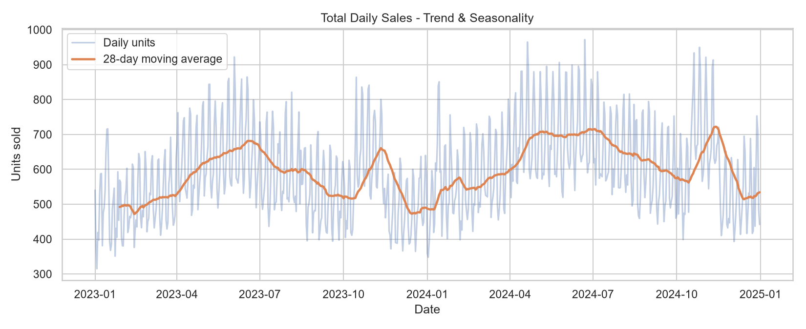
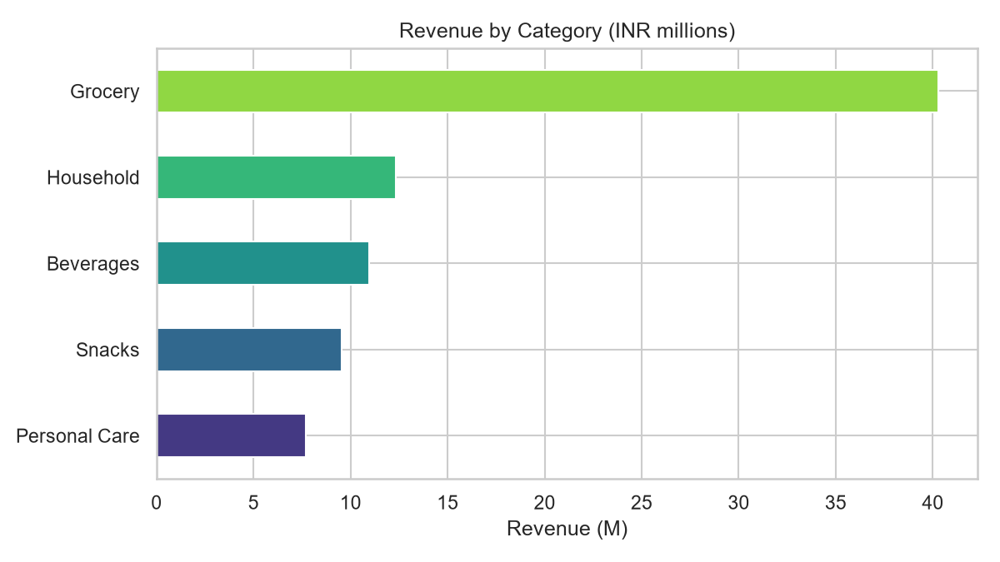
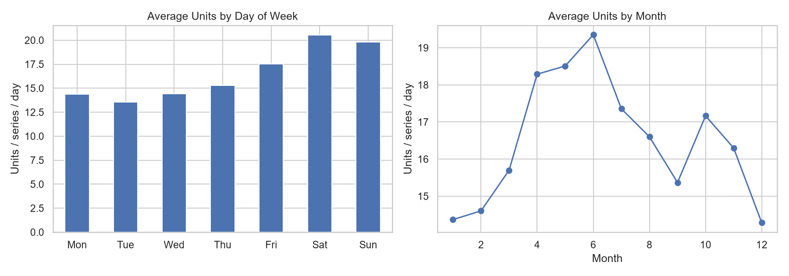
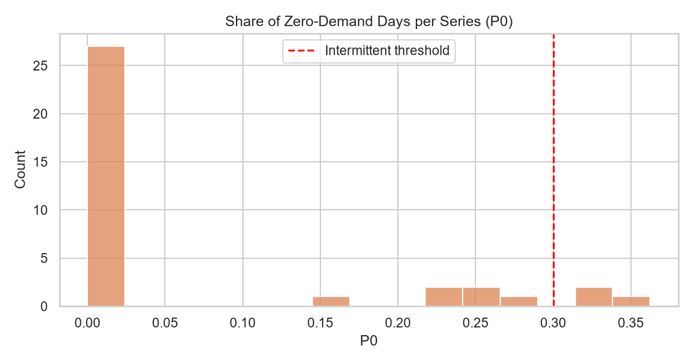
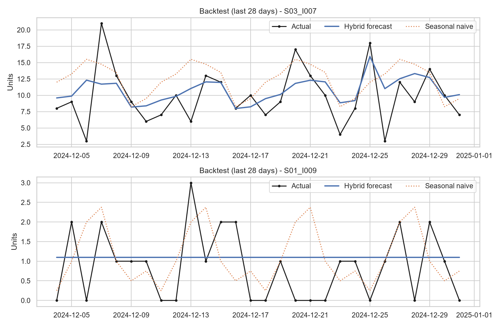
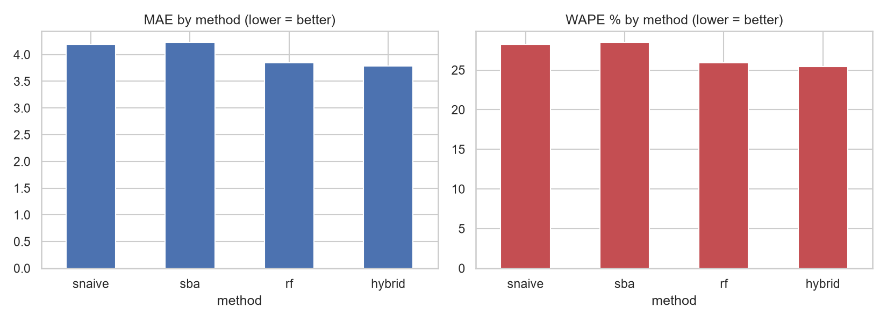
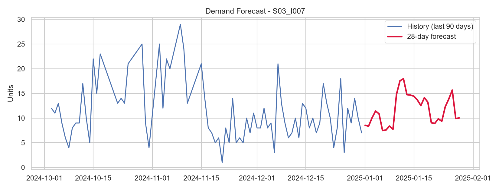
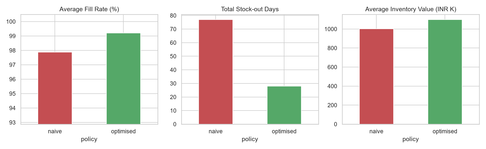
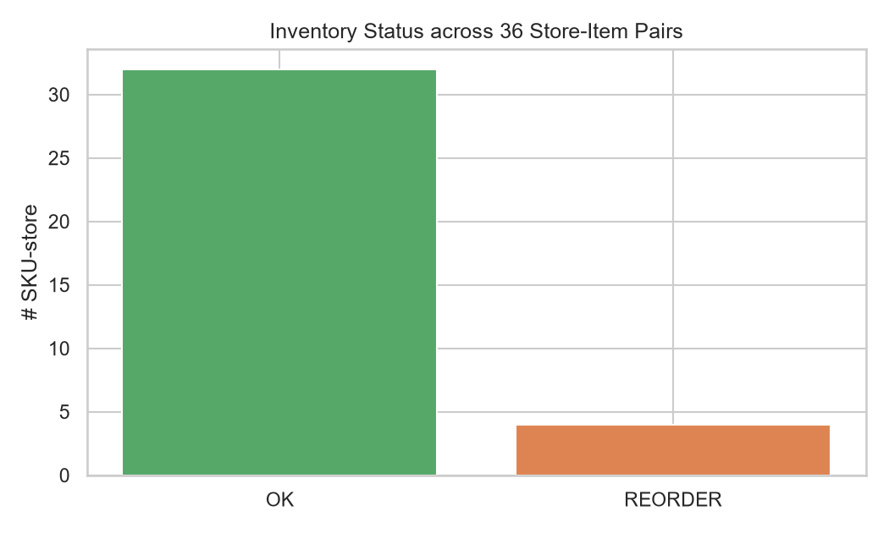
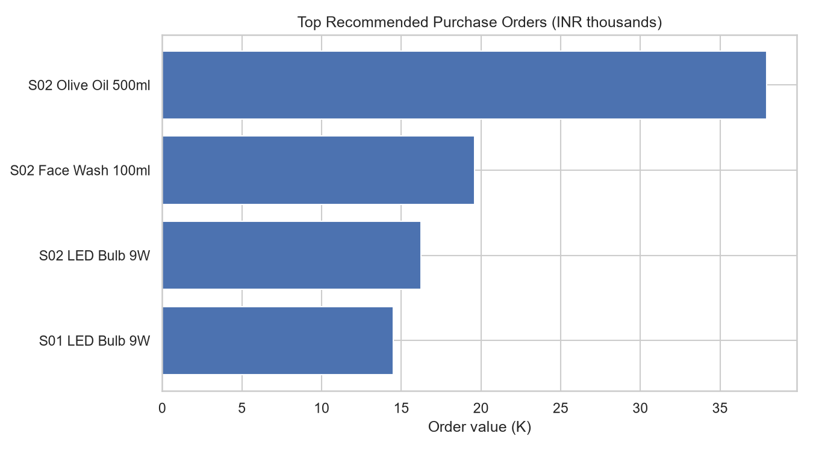

# 📦 Retail Sales Forecasting & Inventory Optimization System

> End-to-end demand forecasting and replenishment engine: **forecast item-level daily sales → compute safety stock, reorder points and EOQ → recommend purchase orders**, validated by a backtest and a policy-replay simulation.

   

## 1. Overview
Retailers lose money in two ways: **stock-outs** (lost sales) and **overstock** (cash locked in inventory). This project turns historical sales into a forecast and then into concrete ordering decisions (*what to order, how much, when*) for every store × item.

Because real retail data is proprietary, the project runs on a **virtual retail simulation** (3 stores × 12 SKUs × 2 years = 26,316 daily records) with trend, weekly/yearly seasonality, festive spikes, promotions, intermittent items, and real stock-outs that censor sales.

## 2. Problem statement
Given daily store-item sales history, (a) forecast the next 28 days, (b) convert forecasts to safety stock, reorder point and order quantity at a 95% service level, and (c) prove the policy reduces stock-outs compared with a naive policy.

## 3. Business value
| Business question | How the project answers it |
|---|---|
| How much will we sell? | 28-day forecast per store-item |
| When must we reorder? | Reorder point = lead-time demand + safety stock |
| How much to order? | EOQ vs. shortfall to reorder point (inventory-position based) |
| Is the policy better? | Replay on last 84 days: fill rate, stock-out days, inventory value |

## 4. Tech stack
Python · Pandas · NumPy · SciPy · scikit-learn (Random Forest) · Croston-SBA (custom) · Matplotlib/Seaborn · Streamlit · Git.

## 5. Architecture
```
 Raw CSV / Simulator ─► Cleaning (QC + stock-out correction) ─► EDA
        │                                                        │
        ▼                                                        ▼
 Feature engineering (lags, rolling, calendar, promo) ─► Hybrid forecaster
        │          Croston-SBA (intermittent) | 0.7·RF + 0.3·Seasonal-naive (regular)
        ▼
 Backtest (MAE/RMSE/MASE/WAPE) ─► residual σ ─► Inventory engine (SS, ROP, EOQ, Q)
        ▼
 Recommendations CSV · KPI replay · Charts · Streamlit dashboard
```

## 6. Folder structure
```
├── main.py                 # one-command pipeline
├── src/                    # config, data_generator, preprocessing, eda, features, models, inventory, visualize
├── app/streamlit_app.py    # planner dashboard
├── tests/test_core.py      # unit tests
├── data/raw/               # simulated dataset
├── outputs/                # forecasts, metrics, recommendations (CSV)
├── images/                 # charts used as proof
├── models/                 # trained model (git-ignored)
├── docs/PROJECT_GUIDE.md   # full walkthrough, GitHub plan, interview prep
└── requirements.txt
```

## 7. Installation
```bash
git clone https://github.com/<your-username>/Retail-Sales-Forecasting-Inventory-Optimization.git
cd Retail-Sales-Forecasting-Inventory-Optimization
python -m venv venv
source venv/bin/activate          # Windows: venv\Scripts\activate
pip install -r requirements.txt
```

## 8. How to run
```bash
python main.py                    # full pipeline (~1-2 min)
streamlit run app/streamlit_app.py
python -m pytest -q               # tests
```

## 9. Dataset
Columns: `date, store_id, city, item_id, item_name, category, qty_sold, price, discount_pct, on_promo, stock_on_hand, on_order, stockout_flag, unit_cost, lead_time_days, holding_cost_rate, ordering_cost, shelf_life_days`. ~4% of days are stock-outs (censored demand), 3 of 36 series are intermittent.

## 10. Methodology
1. **Cleaning** – duplicates/negatives/missing checks; stock-out days are *repaired* (max of sales and interpolated neighbours) instead of dropped so time series stay continuous.
2. **Features** – lags 1/7/14, rolling mean/std 7/14/28 (shifted → no leakage), calendar, holiday, promo, price, encodings.
3. **Hybrid model** – Croston-SBA for series with >30% zero days; otherwise 70% Random Forest + 30% seasonal naive. Recursive multi-step forecasting.
4. **Backtest** – train strictly on the past, forecast the last 28 days, evaluate.
5. **Inventory** – `SS = z·σ·√L`, `ROP = μ_L + SS`, `EOQ = √(2DK/H)`, order when *inventory position* (on-hand + on-order) ≤ ROP.

## 11. Results (reproducible, seed = 42)
**Forecast accuracy – 28-day holdout, 36 store-item series**

| Method | MAE | RMSE | MASE | WAPE % |
|---|---|---|---|---|
| Seasonal naive | 4.19 | 5.13 | 0.761 | 28.2 |
| Croston-SBA | 4.23 | 5.32 | 0.743 | 28.5 |
| Random Forest | 3.85 | 4.82 | 0.694 | 25.9 |
| **Hybrid** | **3.78** | **4.68** | **0.684** | **25.5** |

**Inventory policy replay (last 84 days)**

| Policy | Avg fill rate | Stock-out days | Avg inventory value |
|---|---|---|---|
| Naive (ROP, no safety stock) | 97.9% | 77 | ₹1.00 M |
| **Optimised (with safety stock)** | **99.2%** | **28 (−64%)** | ₹1.10 M (+9.6%) |

> Trade-off made visible: ~10% more inventory value buys a 64% cut in stock-out days.
> Note: results come from simulated data and demonstrate the method, not real retail performance.

## 12. Screenshots
| | |
|---|---|
|  |  |
|  |  |
|  |  |
|  |  |
|  |  |

Add your own dashboard screenshot: `images/13_dashboard.png`.

## 13. Future improvements
Promo-aware future forecasts · LightGBM/Prophet comparison · rolling-origin CV · MLflow tracking · FastAPI endpoint · demand-distribution (quantile) forecasting · perishability/shelf-life constraints · multi-echelon (warehouse → store) · anomaly detection.

## 14. Learning outcomes
Time-series feature engineering without leakage · handling censored demand · intermittent demand (Croston/SBA) · backtesting & MASE/WAPE · safety stock/ROP/EOQ maths · turning ML output into business KPIs · Streamlit deployment · Git/GitHub workflow.

## 15. Author
**Yaswitha Kamakshi** · LinkedIn: (www.linkedin.com/in/yaswitha-kamakshi-292b5242b) · GitHub: (https://github.com/yaswitha-kamakshi).
